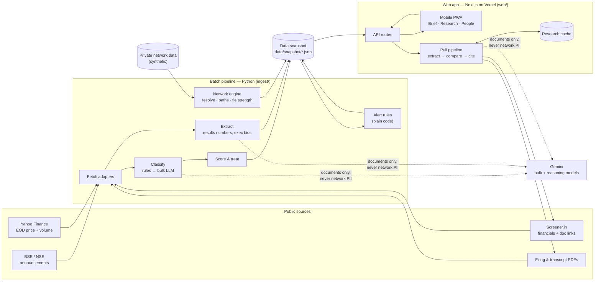
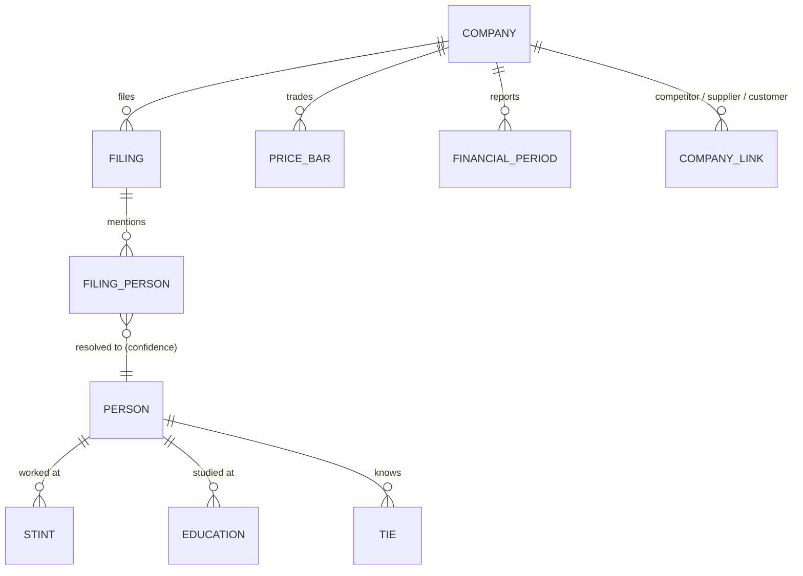

# FINN — Architecture

Status: v1 (T00, will be refined as tasks land) · Requirements: [`requirements.md`](requirements.md) · Tasks: [`tasks.md`](tasks.md)

## 1. Shape of the system

FINN has two halves with very different rhythms:

- **Batch (Push + Network):** filings and prices change at most a few times a day. They are fetched, classified, scored and enriched **ahead of time**, and the results are written as a data snapshot. The app reads that snapshot — fast, cheap, and still working if a source goes down (NFR-01).
- **Interactive (Pull + Ask):** research on an arbitrary ticker can't be precomputed for every company, so it runs **on demand**, and every result is cached so the second request is instant (FR-17).

## 2. Components

| Component | Where | Responsibility | Requirements |
|---|---|---|---|
| Fetch adapters | `ingest/finn/sources/` | `nse` (announcements + integrated-filing results index with XBRL links), `prices` (Yahoo EOD), `screener` (financial tables + annual report / transcript links). All go through one polite client: per-host rate limit, retries, identifying header, disk cache in `data/raw/`. | FR-01, FR-02, FR-11, NFR-10 |
| Classifier | `ingest/finn/classify.py` | Maps each filing to a reference category. Exchange-provided category plus keyword rules first; leftovers sent to the bulk model **in batches**. | FR-03, NFR-04 |
| Scorer | `ingest/finn/score.py` | `score = category weight × investor preference × position weight × network relevance × price reaction`. Stores each factor so the UI can explain the rank. | FR-04, FR-05, NFR-07 |
| Extractors | `ingest/finn/extract/` | Results numbers (structured data first, LLM fallback with checks); incoming-executive bio from appointment filings. | FR-06, FR-07, NFR-06 |
| Network engine | `ingest/finn/network/` | Entity resolution, 1st/2nd-degree paths, tie strength, who-to-call, reasons to reconnect. **Pure code, no LLM.** | FR-18–FR-23, NFR-05 |
| Alert rules | `ingest/finn/alerts.py` | Volume and price thresholds and category subscriptions evaluated on EOD data. | FR-09 |
| Data access layer | `web/lib/data/` | The only module that knows the snapshot is JSON files. Swapping to Postgres changes this module only. | NFR-09 |
| Pull pipeline | `web/lib/pull/` | Resolve ticker → fetch docs → bulk-extract guidance → compute actuals in code → reasoning model compares → citation validator. | FR-11–FR-17, NFR-02 |
| UI | `web/app/` | Brief (Push), Research (Pull), People (Network), alert settings. | FR-10, FR-24, FR-26, NFR-08 |

## 3. Data model (core entities)

- **Filing:** id, company, timestamp, title, exchange category, FINN category, score + factors, summary, attachment URL.
- **Person / Stint / Education:** shared by network contacts and people found in filings, which makes matching a join rather than a special case.
- **Tie:** investor ↔ contact (and contact ↔ contact for second degree): strength 0–1, evidence list, last interaction date.

## 4. LLM usage and model routing

Principle: **use a model only where judgment over unstructured text is needed.** Arithmetic, matching and thresholds are code.

| Step | Model tier | Why this tier |
|---|---|---|
| Classifying filings the rules couldn't place | bulk | Short, high-volume, simple labels; batched ~30 per call. |
| One-line summaries of material filings | bulk | Short inputs, short outputs. |
| Results numbers (fallback only) | bulk | Structured extraction with a JSON schema; output checked in code. |
| Executive bio from an appointment filing | bulk | Extraction into a fixed schema. |
| Guidance statements from transcripts | bulk | Long input, structured output; run once per document and cached. |
| Promised vs delivered verdicts | reasoning | Needs to compare claims against numbers across quarters. |
| Bull vs bear | reasoning | Synthesis; run once per ticker, cached. |
| Network matching, paths, tie strength | **none** | Must be deterministic and explainable, and keeps personal data away from the model. |
| Financial snapshot, QoQ/YoY, ratios | **none** | Arithmetic. |
| Alerts | **none** | Thresholds. |

Model IDs live in one file, [`config/models.json`](../config/models.json), read by both the Python and TypeScript helpers. Each tier is a **fallback chain**: free-tier quotas apply per model, so when one model returns 429 the call moves to the next model in the chain.

Every call is cached by `sha256(model, system prompt, schema, input)`, so a repeated call costs nothing. Every call logs token usage to `data/llm_usage.jsonl`, which feeds the cost report.

**Agents.** The batch pipeline and the Pull pipeline are fixed pipelines: predictable, cacheable and cheap. The only component that plans and calls tools on its own is the Ask bar (FR-25), which gets read-only tools (`get_filings`, `get_financials`, `search_documents`, `network_lookup`).

## 5. Data security and privacy

| Concern | Prototype | Real deployment |
|---|---|---|
| Whose data is it | Synthetic network; no real person's data. | The investor uploads their own LinkedIn data export and meeting notes — data they own, given with consent. |
| What reaches an LLM | Public documents only (filings, transcripts). Network matching runs in code. | Same rule, plus a paid tier with zero data retention. |
| Isolation | Single demo investor. | Per-investor tenancy with database row-level security; network tables encrypted at rest. |
| Retention | Raw fetches cached locally, not committed. | Profile enrichments expire (e.g. 90 days) unless re-confirmed; contacts can be deleted on request. |
| Secrets | `.env` gitignored; Vercel environment variables. | A secrets manager, with keys rotated. |

## 6. Cloud: what runs where

| Piece | Prototype | Why |
|---|---|---|
| Web app + API routes | Vercel (Hobby) | One link that works on any phone; preview deploys per branch. |
| Batch pipeline | Run locally, output committed as the snapshot | Exchange sites often block cloud IPs; a snapshot keeps the demo reliable. |
| LLM | Gemini API (free tier) | ₹0 cost; long context for transcripts. |
| Next step | GitHub Actions cron → Postgres (Supabase) → same data access layer | Scheduled end-of-day refresh without a server to babysit. |

## 7. Key decisions (ADR log)

| # | Decision | Alternatives | Why |
|---|---|---|---|
| ADR-01 | Ranked, triage-card "brief" as the main surface; chat secondary | Chat-first, dashboard | The brief's core problem is filtering. A ranked brief makes filtering the interaction itself. |
| ADR-02 | Next.js PWA on Vercel | Expo, Flutter | A grader taps one link; no app store or Expo Go. |
| ADR-03 | Batch snapshot + on-demand Pull | Everything live | Reliability (NFR-01) and free-tier quota (NFR-04). |
| ADR-04 | Network logic in code, not an LLM | LLM reasoning over contacts | Deterministic, explainable, and keeps personal data private. |
| ADR-05 | Numbers from structured data, LLM only as a checked fallback | LLM reads every results PDF | Numbers must be right; models can make them up. |
| ADR-06 | Gemini free tier with per-model fallback chains | Anthropic (paid), Groq | ₹0 spend; fallback chains and caching work around low daily caps. |
| ADR-07 | Synthetic network + exec bios taken from filings | Scraping LinkedIn | Platform terms; appointment filings carry the bio, which is a primary source. |
| ADR-08 | NSE as the filings source; BSE dropped | BSE API primary | T01 spike: BSE's API returned 403 (Akamai) to scripted clients; NSE's API answered with full text plus attachment links. |
| ADR-09 | Results numbers from NSE "Integrated Filing – Financials" XBRL | NSE legacy results API, Screener tables, LLM on PDF | The legacy endpoint stops at Dec 2024 (SEBI moved results to integrated filings in 2025). The XBRL has Revenue, PBT, PAT, finance costs and D&A for the quarter (context `OneD`), so EBITDA is computed, not guessed. Values were checked against Screener for RELIANCE Q2 FY27. |
| ADR-11 | Portfolio chosen by scanning ~78 names for real recent events (`scan_universe.py`) | Hand-picked blue chips | Puts genuine management changes, M&A, results and outsized moves (PIIND −19% on 17× volume, RELIANCE +11.6% on 4×) in the demo window, across 18 sectors. |
| ADR-12 | Snapshot builder keeps the previous data for any company whose fetch fails | Fail the whole run | A flaky exchange endpoint must never wipe good data (NFR-01). |
| ADR-10 | Raw `Close` from Yahoo, not `Adj Close` | Adjusted close | `Adj Close` was inconsistent for some NSE tickers in the spike; alerts only need day-over-day moves and volume ratios. |
