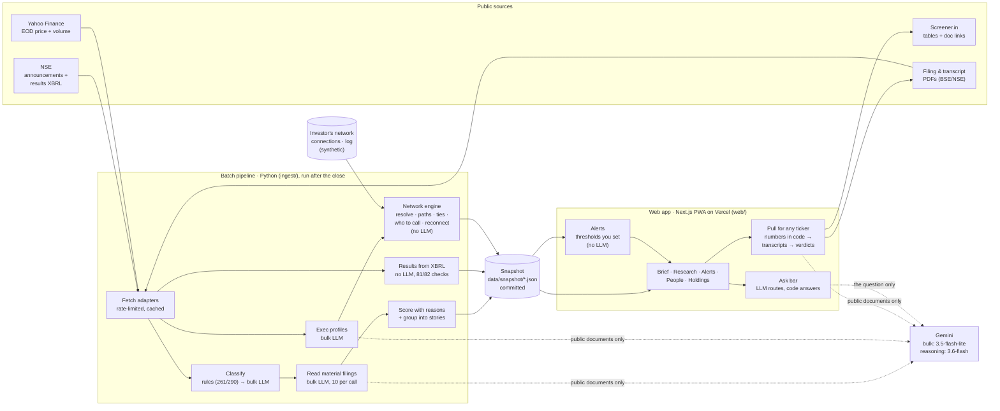
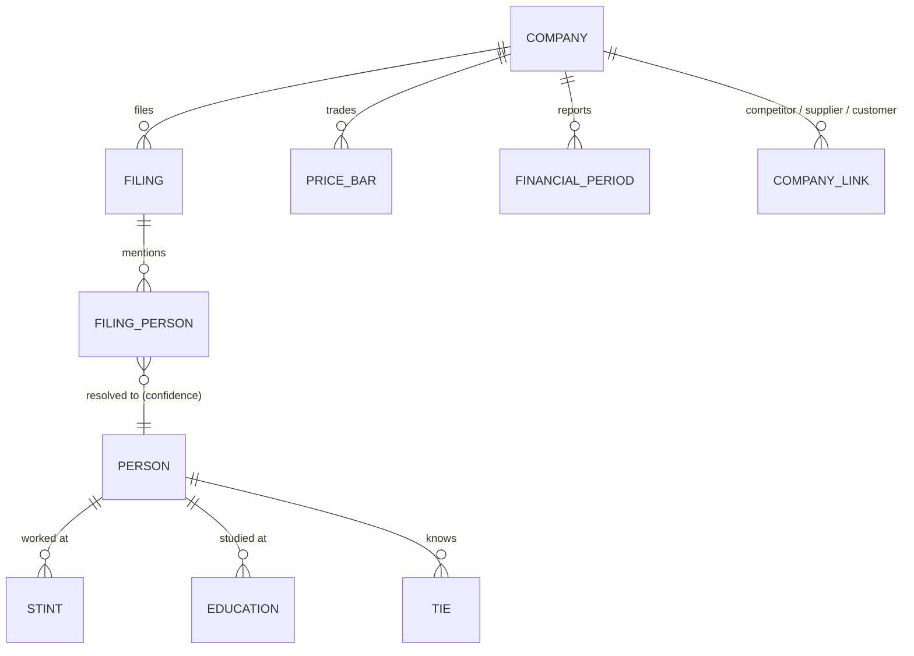

# FINN — Architecture

Status: as built for v1.0 · Requirements: [`requirements.md`](requirements.md) · Tasks: [`tasks.md`](tasks.md) · Cost: [`cost.md`](cost.md)

## 1. Shape of the system

FINN has two halves with very different rhythms:

- **Batch (Push + Network):** filings and prices change at most a few times a day. They are fetched, classified, scored and enriched **ahead of time**, and the results are written as a data snapshot. The app reads that snapshot — fast, cheap, and still working if a source goes down (NFR-01).
- **Interactive (Pull + Ask):** research on an arbitrary ticker can't be precomputed for every company, so it runs **on demand**, and every result is cached so the second request is instant (FR-17).

**What never reaches a model:** contacts, relationships, interaction notes, tie strengths. Matching and paths run in code; the Ask bar's model sees only the question and the public company list.

## 2. Components

| Component | Where | Responsibility | Requirements |
|---|---|---|---|
| Fetch adapters | `ingest/finn/sources/` | `nse` (announcements + integrated-filing results index with XBRL links), `prices` (Yahoo EOD), `screener` (financial tables + annual report / transcript links). All go through one polite client: per-host rate limit, retries, identifying header, disk cache in `data/raw/`. | FR-01, FR-02, FR-11, NFR-10 |
| Classifier | `ingest/finn/classify.py` | Maps each filing to a reference category: ordered text rules, then NSE's label; leftovers go to the bulk model. Records which rule fired. | FR-03, NFR-04 |
| Reader + scorer | `ingest/finn/enrich.py`, `score.py` | Bulk model reads material filings (headline, one-line summary, fact-cited materiality); score = category × preference × position × network × price reaction × materiality, each factor with a sentence; filings grouped into stories. | FR-03–FR-05, NFR-07 |
| Results | `ingest/finn/xbrl.py`, `results.py` | Revenue, EBITDA, PBT, PAT with QoQ/YoY from exchange XBRL; lender-aware; profit identity and Screener cross-checks. | FR-07, NFR-06 |
| People in filings | `ingest/finn/people.py` | Executive profiles from appointment filings (bulk model) into the network's `Person` schema; honest date handling; paths attached. | FR-06, FR-19 |
| Network engine | `ingest/finn/network/` | Org registry, entity resolution, tie strength, 1st/2nd-degree paths, who to call, best person per event, reasons to reconnect. **Pure code, no LLM.** | FR-08, FR-18–FR-23, NFR-05 |
| Data access layer | `web/lib/data.ts`, `people.ts` | The only modules that know the snapshot is JSON. Swapping to Postgres changes these only. | NFR-09 |
| Pull | `web/lib/pull/` | Any ticker: snapshot or live Screener fetch → computed analysis → transcripts → quote-checked guidance → reasoning comparison → citation validator. | FR-11–FR-17, NFR-02 |
| Alerts | `web/lib/alerts.ts` | Thresholds the investor sets, evaluated on EOD data in the app; each move linked to its likely cause. | FR-09 |
| Ask bar | `web/lib/ask.ts` | Bulk model routes the question to one of eight intents; code answers. Keyword fallback. | FR-25, NFR-05 |
| UI | `web/app/`, `web/components/` | Brief, Research, Alerts, People, Holdings; company and person pages. | FR-10, FR-24, FR-26, NFR-08 |

## 3. Data model (core entities)

- **Filing:** id, company, timestamp, title, exchange category, FINN category, score + factors, summary, attachment URL.
- **Person / Stint / Education:** shared by network contacts and people found in filings, which makes matching a join rather than a special case.
- **Tie:** investor ↔ contact (and contact ↔ contact for second degree): strength 0–1, evidence list, last interaction date.

## 4. LLM usage and model routing

Principle: **use a model only where judgment over unstructured text is needed.** Arithmetic, matching and thresholds are code.

| Step | Model tier | Why this tier |
|---|---|---|
| Classify filings the rules couldn't place + headline, summary, materiality | bulk (`3.5-flash-lite`) | Short structured extraction, 10 filings per call. |
| Executive profiles from appointment filings | bulk | Extraction into the network's schema, 3 filings per call. |
| Guidance statements from transcripts (verbatim quote + page) | bulk, thinking off | Long input, structured output; one call per transcript. |
| Promised vs delivered verdicts + bull/bear | reasoning (`3.6-flash`), thinking ≤ 2k tokens | The one step that needs judgement across quarters. |
| Ask bar routing | bulk | Question → intent; never reads data. |
| Results numbers | **none** | Exchange XBRL; numbers must be exact. |
| Network matching, paths, ties, who to call, reconnect | **none** | Deterministic, explainable, and keeps personal data away from any model. |
| Snapshot, trajectory, ratios, alerts | **none** | Arithmetic and thresholds. |

Model IDs live in one file, [`config/models.json`](../config/models.json), read by both the Python and TypeScript helpers. Each tier is a **fallback chain**: free-tier quotas apply per model, so on 429 (quota), 503 (overloaded) or 404 (retired) the call moves to the next model. The order came from a latency benchmark on the real prompt (ADR-41).

Every call is cached by a hash of (tier, system prompt, schema, input), so a repeated call costs nothing. Python calls log token usage to `data/llm_usage.jsonl`; Pull results carry their own usage. Measured numbers are in [`cost.md`](cost.md).

**Agents.** The batch pipeline and the Pull pipeline are fixed pipelines: predictable, cacheable and cheap. The Ask bar (FR-25) is deliberately *not* a free-roaming agent: the model only routes the question to one of eight read-only intents (experts, who to call, company news, results, research, person, reconnect, unknown), and code executes the intent. See ADR-49.

## 5. Data security and privacy

| Concern | Prototype | Real deployment |
|---|---|---|
| Whose data is it | Synthetic network; no real person's data. | The investor uploads their own LinkedIn data export and meeting notes — data they own, given with consent. |
| What reaches an LLM | Public documents (filings, transcripts) and the investor's typed question for routing. Never contacts, relationships or notes. This matters doubly on Gemini's free tier, whose prompts may be used to improve Google's products. | Same rule, on a paid tier with zero data retention. |
| Personal data FINN stores | Per contact: name, career stints, education, expertise tags, the investor's own interaction log. People in filings: only what the filing discloses. | The same minimum, sourced from the investor's own exports with consent; nothing scraped. |
| Isolation | Single demo investor. | Per-investor tenancy with database row-level security; network tables encrypted at rest. |
| Retention | Raw fetches cached locally, not committed. | Profile enrichments expire (e.g. 90 days) unless re-confirmed; contacts can be deleted on request. |
| Secrets | `.env` gitignored; Vercel environment variables. | A secrets manager, with keys rotated. |

## 6. Cloud: what runs where

| Piece | Prototype | Why |
|---|---|---|
| Web app | Vercel (Hobby): static pages for the snapshot (91 prerendered), serverless functions for live Pull (`maxDuration` 120 s), search and Ask | One link that works on any phone; production from `main`, a preview URL per branch. |
| Batch pipeline | Run locally after the close; output committed as the snapshot | Exchange sites can block cloud IPs; a committed snapshot keeps the demo reliable and reviewable in git. |
| Caching | Screener and PDF fetches through Next's fetch cache (persists across serverless instances); Pull results in memory per instance; demo tickers precomputed | Free-tier quota and latency. |
| LLM | Gemini API, free tier | ₹0; see `cost.md`. |
| Next step | GitHub Actions cron after each close → Postgres (Supabase) behind the same data modules → a KV store for live Pull results → web push for alerts | A daily refresh with no server to babysit. |

## 7. Key decisions (ADR log)

| # | Decision | Alternatives | Why |
|---|---|---|---|
| ADR-01 | Ranked, triage-card "brief" as the main surface; chat secondary | Chat-first, dashboard | The brief's core problem is filtering. A ranked brief makes filtering the interaction itself. |
| ADR-02 | Next.js PWA on Vercel | Expo, Flutter | A grader taps one link; no app store or Expo Go. |
| ADR-03 | Batch snapshot + on-demand Pull | Everything live | Reliability (NFR-01) and free-tier quota (NFR-04). |
| ADR-04 | Network logic in code, not an LLM | LLM reasoning over contacts | Deterministic, explainable, and keeps personal data private. |
| ADR-05 | Numbers from structured data, LLM only as a checked fallback | LLM reads every results PDF | Numbers must be right; models can make them up. |
| ADR-06 | Gemini free tier with per-model fallback chains | Anthropic (paid), Groq | ₹0 spend; fallback chains and caching work around low daily caps. |
| ADR-07 | Synthetic network + exec bios taken from filings | Scraping LinkedIn | Platform terms; appointment filings carry the bio, which is a primary source. |
| ADR-08 | NSE as the filings source; BSE dropped | BSE API primary | T01 spike: BSE's API returned 403 (Akamai) to scripted clients; NSE's API answered with full text plus attachment links. |
| ADR-09 | Results numbers from NSE "Integrated Filing – Financials" XBRL | NSE legacy results API, Screener tables, LLM on PDF | The legacy endpoint stops at Dec 2024 (SEBI moved results to integrated filings in 2025). The XBRL has Revenue, PBT, PAT, finance costs and D&A for the quarter (context `OneD`), so EBITDA is computed, not guessed. Values were checked against Screener for RELIANCE Q2 FY27. |
| ADR-10 | Raw `Close` from Yahoo, not `Adj Close` | Adjusted close | `Adj Close` was inconsistent for some NSE tickers in the spike; alerts only need day-over-day moves and volume ratios. |
| ADR-11 | Portfolio chosen by scanning ~78 names for real recent events (`scan_universe.py`) | Hand-picked blue chips | Puts genuine management changes, M&A, results and outsized moves (PIIND −19% on 17× volume, RELIANCE +11.6% on 4×) in the demo window, across 18 sectors. |
| ADR-12 | Snapshot builder keeps the previous data for any company whose fetch fails | Fail the whole run | A flaky exchange endpoint must never wipe good data (NFR-01). |
| ADR-13 | Network inputs mirror what an investor really has: a LinkedIn-style `connections.csv`, an interaction log, and their own background | A hand-made graph | Onboarding cost is one export plus a habit of logging meetings. Shared history (same batch, ex-colleagues) is *detected* from both careers, not typed in. |
| ADR-14 | One `Person` schema for contacts and for executives found in filings | Separate models | Matching a filing to the network becomes comparing two careers: same org, same unit, overlapping months, same school and years. |
| ADR-15 | Tie strength = small additive model with a sentence per point; path strength = product of hops | Graph embeddings, LLM judgement | Every number on screen can be explained ("overlapped 9 yrs in Wipro's Americas 2 unit while Guha ran it"). Unknown dates lower confidence instead of being guessed. |
| ADR-16 | Paths ranked by strength, but a confirmed direct acquaintance is always shown | Direct ties first | Meeting someone once in 2024 shouldn't outrank a batchmate who worked in their unit for 9 years; but "you've met them" is still worth knowing. |
| ADR-17 | A UPSI caution on any path or suggestion through a current employee of the company | No caution | Real compliance risk for an investor; the network should make the right call easy. |

| ADR-18 | Hybrid classification: ordered text rules → NSE label → bulk LLM only for leftovers | LLM classifies everything | Rules settle 261/290 filings for free and traceably (`rule` field). The LLM handled the 29 vague "General Updates", and found HDFC Bank's CEO handover hidden in one. |
| ADR-19 | The LLM reads only potentially material filings (144/290), 10 per call, and returns headline, one-line summary and a *materiality* judgement | Summarise everything; no LLM | Routine paperwork never costs a token. 15 calls per full refresh, cached by content hash, so re-scoring is free. |
| ADR-20 | Materiality must cite a fact from the filing and is judged against company size (large/mid cap) | Free-text reason | First pass gave generic reasons ("results impact valuation") and rated a USD 2,000 stake "high". Forcing a cited fact plus size context fixed both: no AI slop on the card. |
| ADR-21 | Score = product of explainable factors, squashed by `100·p/(p+0.5)`; tiers top ≥ 66, notable ≥ 36 | Raw product, capped | Raw products piled 95 filings at 100. The squash keeps order and gives 0–4 top stories per day. |
| ADR-22 | Filings about the same company, category and day are grouped into one story | One card per filing | Results day produces 4–6 filings; the investor wants one story with the rest attached. |

| ADR-23 | The Brief opens with a count, not a feed: "Two things matter. 4 worth a glance. 15 routine filings filed away." | Chronological feed, dashboard | States the product thesis on the first screen; the investor knows in one line whether to keep reading. |
| ADR-24 | Three tiers on screen: full cards (top), one-line rows (notable), one collapsed line (routine) | Equal-weight list | Density follows importance, which is what "bury everything else, beautifully" asks for. |
| ADR-25 | Triage by swipe (left done, right later) mirrored by buttons; state per viewer in `localStorage` via `useSyncExternalStore` | Server-side state; gestures only | Triage is a personal convenience, needs no backend for the prototype, and must work without gestures (accessibility). A snooze lasts until the next data snapshot. |
| ADR-26 | One "people" colour (amber) used only for the network, on every surface | Network as a separate tab | The network should feel like a quiet advantage woven into Push, not a contact list beside it. |
| ADR-27 | The web app reads a copy of the snapshot synced into `web/data/` at `predev`/`prebuild`, through one data module (`web/lib/data.ts`) | Reading `../data` at runtime | The Next.js bundle never reaches outside its folder (Vercel root dir = `web`); every page prerenders statically. |

| ADR-28 | Executive profiles come from the appointment filing itself (SEBI requires a "brief profile"), extracted by the bulk model into the network's `Person` schema, 3 filings per call | LinkedIn lookup; reasoning model | Primary, legal source. 12 calls for 35 filings; recalls 11/11 employers against hand-built fixtures (`extract_people.py --eval`). The model never sees the network. |
| ADR-29 | Dates are never invented: a role followed by one that has started is closed (or marked `end_unknown`); a future-dated role doesn't end today's; joining a different group ends the current employer; estimated years shown as "around" | Trust the model's `to: null` | The first extraction left Banga "at TPDDL 2003–present", which would have fabricated overlaps. Honesty beats a stronger-looking path. |
| ADR-30 | Two new kinds of evidence: "same career path" (both moved A → B, counted only where their time could have overlapped) and "joined first" bounded overlap | Only dated overlaps | Recovers real signal when filings omit years (Rohan followed Guha Wipro → Birlasoft) without accepting false ones (both went NTPC → TPREL, 20 years apart). |
| ADR-31 | The path UI shows each hop's own strength, a reason per hop, a UPSI caution, "you've met them", and an explicit negative ("No one in your network has crossed paths with Ritu") | Show only positive matches | The investor can judge the path themselves; silence would hide whether FINN looked. |

| ADR-32 | Results card reads the quarter's XBRL context (a ~3-month duration ending on the quarter date, no dimensions); QoQ and YoY come from the earlier quarters' own filings | Screener table; LLM on the PDF | Numbers straight from the exchange's structured filing. The headline ("Q2 FY27: Revenue +15% YoY, PAT +16% YoY") is computed, not written. |
| ADR-33 | EBITDA = PBT before exceptional items + finance costs + D&A − other income; lenders get their own lines (bank: NII and pre-provision profit; NBFC: EBITDA "not meaningful") | One formula for all | EBITDA means nothing when interest is the cost of goods; showing it would mislead. |
| ADR-34 | Every card carries checks: the profit identity (PBT − tax + JV share + discontinued ops + regulatory deferral = profit) and three cross-checks against Screener; failures are shown, not hidden | Trust the parse | The first run failed 17/82 checks, each a real accounting nuance (JV share below PBT, Ind AS 114 deferrals for power utilities, bank revenue definitions). After the fixes 81/82 pass to the rupee; ITC's gross-vs-net revenue gap is shown on the card as a divergence. |

| ADR-35 | Pull runs live in the web app (TypeScript): Screener fetch + parse for any ticker, with a committed snapshot for the 22 known ones | Python-only Pull; live for all | Any NSE ticker works on demand (verified on ASTRAL and MARICO, which were never fetched by the pipeline); known tickers never depend on Screener being reachable from the host. The TS parser mirrors `screener.py` field for field. |
| ADR-36 | Caching: Screener HTML through the `fetch` cache (`revalidate: 1 day`); known tickers prerendered via `generateStaticParams`; unknown ones render once behind `<Suspense>` with a progress fallback and are then kept | `use cache` only | Per the Next 16 docs, in-memory `use cache` entries don't persist across serverless instances, but the fetch cache does. |
| ADR-37 | The snapshot, trajectory, margins, cash conversion, leverage and working capital are arithmetic in code; each signal names its source table | Ask a model to "analyse" the numbers | Numbers need no model; a model would add cost and risk. The LLM is saved for what needs reading (guidance in transcripts, T09). |
| ADR-38 | Lenders get different lines: net profit margin instead of OPM/financing margin, ROE instead of ROCE, no cash-conversion or D/E | Same template for everyone | Screener's financing margin goes negative for consolidated banks with insurance arms (HDFC Bank showed −12%); D/E and CFO are meaningless when lending is the business. |

| ADR-39 | Promised vs delivered = extract (bulk, one call per transcript, verbatim quote + page) → actuals in code (A-ids) → compare (reasoning, cites only G/A ids) → validator | One long-context "analyse these transcripts" call | Each stage is checkable: quotes are matched against the page text (ASIANPAINT: 3 failed and were dropped); the comparison can only cite ids that exist; numbers never come from the model. |
| ADR-40 | Verdicts include `on_track` / `off_track` for periods still running | met/missed/too_early only | The first run marked everything "too early" (summarising, not analysing). "Positive FY27 growth" against H1 −10% YoY is the call an analyst wants. |
| ADR-41 | Thinking off for bulk extraction, capped for comparison; reasoning chain re-ordered by a latency benchmark (3.6-flash ~3 s; 3.8 overloaded; 3.7 ~360 s; 2.5 retired) | Default model settings | A ticker went from ~220 s to 6–42 s. On 503 the chain moves on instead of queueing. |
| ADR-42 | Live LLM work runs only for real requests (`await connection()`); demo tickers are precomputed by the same code (`scripts/precompute-pull.ts`) into `data/snapshot/pull.json` | Prerender everything; live for all | Without this, every Vercel build would spend ~70 model calls. Precompute makes the demo instant and independent of the API key. |
| ADR-43 | Companies without earnings calls (Trent) get an explicit "no transcripts" message, not an error | Treat as failure | It's a fact about the company, not a fault in FINN. |

| ADR-44 | Material events (M&A, capex, litigation, fund raises) name the person best placed to explain *that event*: score = tie × relation × fit, where fit rewards a matching role (legal/regulatory, strategy/BD, projects/ops, finance) and, most, expertise in the event's subject | Reuse "who do I know at this company" | "Who can explain the Vishay OSAT JV" is Kunal (runs semiconductor assembly), not the person who left Kaynes in 2022. Generic sector words ("financials") don't count as subject knowledge; first run matched "financial statements". |
| ADR-45 | Who to call inside Pull works for any ticker: precomputed ranking for known companies; for others, the company name is matched against every contact's career in the web app | Known companies only | The network has to answer inside Pull for any NSE ticker (SYRMA → Priya, INFY → Neha), and say so plainly when no one has (ASTRAL). |

| ADR-46 | Alerts are evaluated in the app, on end-of-day data, as pure functions of the investor's thresholds (`web/lib/alerts.ts`); thresholds persist per viewer | Precompute alerts in the batch pipeline | "I decide what unusual means" becomes tangible: moving the volume slider from 2× to 4× changes the inbox from 18 alerts to 13 instantly. Production adds a scheduled run after each close with web-push notifications. |
| ADR-47 | Every price/volume alert names its likely cause (the most material filing between the previous close and this one, results first) or says it is follow-through from the previous unusual session | Bare "PIIND −19%" | "Fell 19.1% on 30× volume · likely cause: Q2 FY27 PAT −63%" is the alert worth sending. A move with no filing behind it is flagged as "worth a look". |

| ADR-48 | Reasons to reconnect = contacts dormant 6+ months × a material event at their current/former employer (or a competitor they work at) in the last 14 days, at most two per event type | "You haven't spoken to X" reminders | A reason to call beats a reminder to call. Capping per type keeps results season from turning every nudge into "they reported"; transcript and AGM filings are not reasons. |

| ADR-49 | The Ask bar's model is a router, not a reader: it maps the question to one of 8 intents with arguments (bulk model, JSON schema, ~1.4 s); code answers from the snapshot and network; keyword routing is the fallback | A tool-calling agent that reads results back | Keeps NFR-05 intact: only the question and the public company list reach the model, never contacts or relationships. Answers are exact (no paraphrased data) and it still works with no API key. |
| ADR-50 | Person pages gather "where they can help": ways in to new executives, events they're best placed to explain, who-to-call entries, reconnect reasons; the People tab's expertise map doubles as a filter | A contact list | "What does the network notice that I wouldn't" is answered per person, from the same engine that powers Push and Pull. |

| ADR-51 | Performance budget checked on a production build (gzipped): Brief 44 KB, Alerts 33 KB, Research 16 KB, person page 5 KB; all JS for every route 241 KB. Routine stories ship as titles only | Ship full story objects | Every view is usable on a phone on a weak connection; the remaining Brief weight is React's double payload (HTML + hydration data), worth restructuring only if the snapshot grows. |
| ADR-52 | PNG icons rendered from the SVG's geometry (`web/scripts/make-icons.py`), a maskable icon, Apple touch icon, branded error/not-found pages, keyboard focus rings | SVG-only icon, framework defaults | iOS ignores SVG home-screen icons; a grader adding FINN to a phone should see FINN, not a blank tile. |

### Push ranking factors (`ingest/finn/score.py`)

| Factor | Range | Example reason shown on the card |
|---|---|---|
| Category (+ subtype, seniority) | 0.02–1.0 | "Management change at the top (CEO/MD/CFO level)" |
| Investor preference | 0.3–1.2 | "You asked to see more of these" |
| Position size | 0.75–1.12 | "9% of your portfolio" / "On your watchlist" |
| Network | 1.0–1.1 | "You know people here: Harsh Vora (current, Tata Power Renewable Energy)" |
| Price reaction | 1.0–1.35 | "Stock fell 19.1% on 30.1x usual volume that session" |
| Materiality (LLM read) | 0.4–1.25 | "FINN read the filing: high, secures transmission project worth Rs 243 crore" |

### Network inputs (synthetic in this prototype)

| File | Real-world equivalent |
|---|---|
| `data/network/investor.json` | Onboarding: the investor's own schools and employers |
| `data/network/connections.csv` | LinkedIn "Connections" data export (same columns) |
| `data/network/profiles.json` | Career/education enrichment of each connection, gathered with consent |
| `data/network/interactions.csv` | Calendar / CRM meeting log |
| `config/orgs.json` | Canonical org registry: aliases, subsidiaries → group, NSE symbol |
| `config/company_links.json` | Competitors / suppliers / customers per company, for who-to-call |
